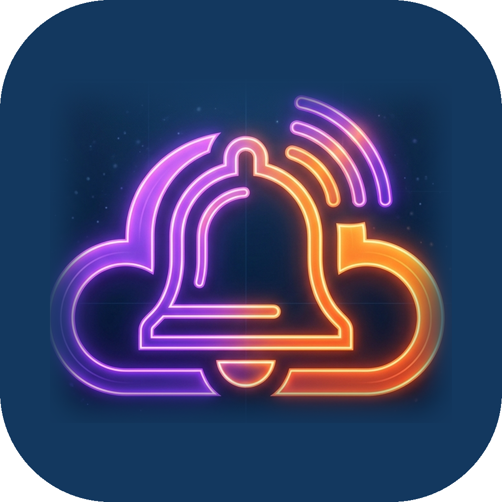

<div align="center">



# DeployBell

**Hear the moment your Cloudflare Pages build succeeds or fails.**

A small desktop app that lives in your system tray, watches your Cloudflare Pages
deployments and rings with a native notification and a sound the instant a build
changes state. Click the notification to open the deployment.

[](https://github.com/harshaldevvv/deploybell/releases/latest)
[](https://github.com/harshaldevvv/deploybell/actions/workflows/release.yml)
[](LICENSE)

</div>

---

## Download

Grab the file for your computer from the [**latest release**](https://github.com/harshaldevvv/deploybell/releases/latest):

| Platform | File |
| --- | --- |
| Windows (Intel / AMD) | `DeployBell-<version>-win-x64.exe` (installer) or `DeployBell-<version>-portable-x64.exe` (no install) |
| Windows (ARM, e.g. Surface Pro X / Snapdragon) | `DeployBell-<version>-win-arm64.exe` or `DeployBell-<version>-portable-arm64.exe` |
| macOS (Apple Silicon and Intel) | `DeployBell-<version>-mac-universal.dmg` |
| Linux (x64 / ARM64) | `.AppImage` or `.deb` for your architecture |

> The app is not code-signed yet. On **Windows**, SmartScreen may show "Windows protected your PC":
> click **More info → Run anyway**. On **macOS**, right-click the app and choose **Open** the first time,
> or run `xattr -cr /Applications/DeployBell.app`.

## What you need

1. A **Cloudflare API token** with **Pages: Read** permission.
   In the Cloudflare dashboard: **My Profile → API Tokens → Create Custom Token**,
   permission `Account → Cloudflare Pages → Read`, scoped to your account.
2. Your **Cloudflare Account ID** (it is in the dashboard URL).

Open DeployBell, paste both into **Settings**, tick the projects to watch, and you are done.

## Features

- **Dashboard:** live status cards (success, failed, building, cancelled) with environment, short deployment ID and relative time.
- **Notifications you can click:** each one opens that deployment in your browser.
- **Sounds:** a different sound for success, failure and cancel, a test button, or pick your own `.wav`.
- **Lives in the tray:** start minimized, close to tray, start at login, mute from the tray menu.
- **Polling you control:** from every 5 seconds to every 2 minutes.
- **Activity log:** every API check and state change, for when something looks off.

Your token is stored only on your computer (`~/.cf-pages-notifier.json`) and is sent only to the
Cloudflare API. See [PRIVACY.md](PRIVACY.md).

## Build from source

```bash
git clone https://github.com/harshaldevvv/deploybell.git
cd deploybell
npm install
npm start          # run the app
npm run dist       # build installers for your OS into dist/
```

Pushing a `v*` tag builds every platform on GitHub Actions and attaches the installers to a draft release.

### Command line mode (Windows)

```bash
npm run cli              # watch from the terminal
npm run cli:configure    # setup wizard
npm run cli:test-notify  # test the notification and sound
```

The desktop app and the CLI share the same settings file.

## Contributing

Issues and pull requests are welcome. See [CONTRIBUTING.md](CONTRIBUTING.md).

## License

[MIT](LICENSE). DeployBell is an independent project and is not affiliated with or endorsed by Cloudflare.
